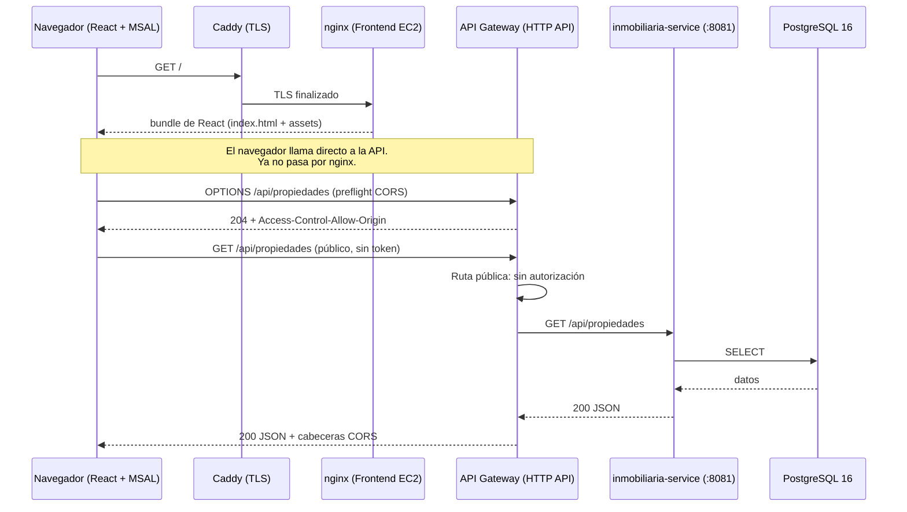
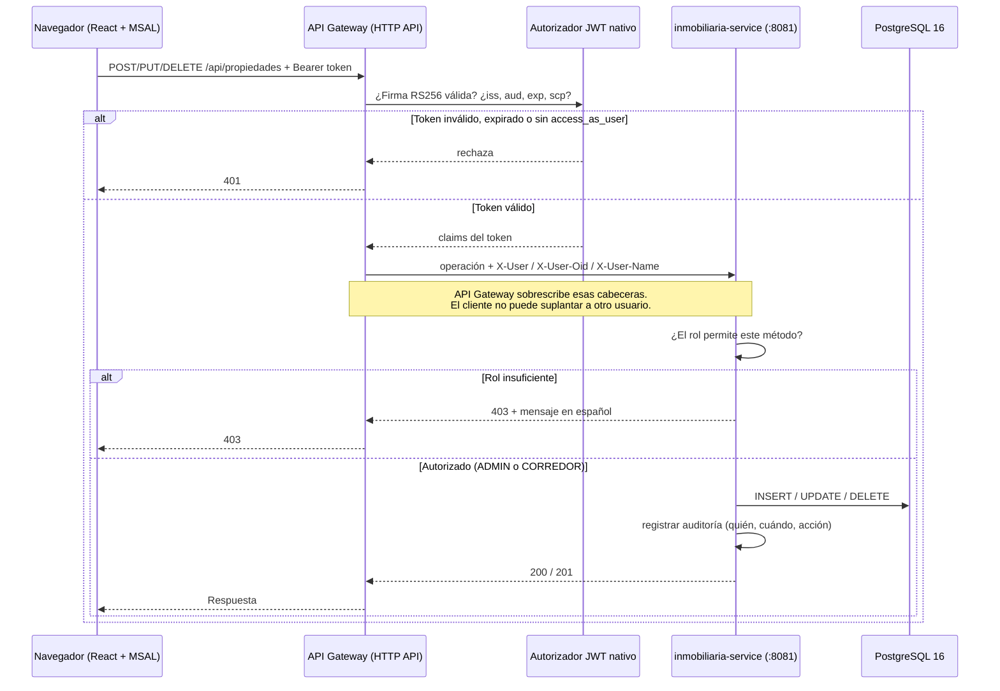
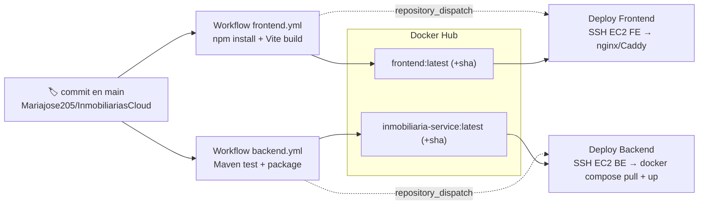

# Diagrama Arquitectónico — Inmobiliarias Duoc

> Diagramas en [Mermaid](https://mermaid.js.org/). Se renderizan automáticamente en
> GitHub, VS Code (extensión Mermaid) y editores con soporte Mermaid.
>
> La API ya no es una aplicación propia: es un **API Gateway (HTTP API) de AWS**.
> Se eliminaron el `api-gateway` de Spring Boot y el proxy `/api` de nginx.

## 1. Arquitectura general (runtime + infraestructura en la nube)

```mermaid
flowchart TB
    U["👤 Usuario final<br/>Navegador (PC / móvil)"]

    DNS["🌐 DNS Dinámico · DuckDNS<br/>inmobiliariasduoc.duckdns.org"]

    AZ["🏢 Microsoft Entra ID<br/>tenant 680da6eb-… · SSO OAuth 2.0 / OIDC<br/>MSAL: access token api://…/access_as_user"]

    subgraph FE["☁️ AWS · EC2 Frontend — 54.156.18.1"]
        CD["Caddy<br/>TLS · Let's Encrypt (HTTPS)"]
        NG["nginx<br/>Solo estáticos React (build Vite)"]
    end

    subgraph APIGW["☁️ AWS · API Gateway (HTTP API)"]
        CORS["🌐 CORS<br/>Orígenes, métodos y cabeceras<br/>listas explícitas"]
        JWT["🔑 Autorizador JWT nativo<br/>iss · aud · exp · nbf · iat · scp<br/>Sin Lambda"]
        VL["🔗 VPC Link<br/>ENIs privadas"]
    end

    subgraph BE["☁️ AWS · EC2 Backend — 34.204.64.107"]
        SG["🔐 Security Group AWS<br/>Entrada 8081 solo desde el VPC Link"]
        subgraph DC["Docker · docker-compose"]
            MS["inmobiliaria-service · :8081<br/>CRUD · Auditoría<br/>Matriz de roles por método"]
            PG[("PostgreSQL 16 · :5432<br/>db propiedades · auditoría")]
        end
    end

    REG[("📦 Docker Hub<br/>mariacarrero/inmobiliarias-frontend<br/>…/inmobiliaria-service")]

    subgraph GH["🐙 GitHub · Mariajose205"]
        APP["InmobiliariasCloud<br/><i>código fuente + workflows</i>"]
        INFRA["inmobiliarias-infra<br/><i>workflows de deploy (SSH)</i>"]
        CFN["☁️ CloudFormation<br/>api-gateway.yaml<br/>crea API, CORS, autorizador, VPC Link"]
    end

    U -->|HTTPS| DNS
    DNS -->|resuelve a| FE
    U -->|SSO login / redirección| AZ
    AZ -->|id_token + access_token| U
    CD --> NG
    NG -->|estáticos| CD

    U -->|HTTPS + Bearer<br/>origen:ducdns.org| APIGW
    APIGW -->|X-User · X-User-Oid| MS
    MS -->|JPA/Hibernate| PG

    CFN -.->|gestiona| APIGW

    APP -->|push main → build + tests + push imagen| REG
    REG -->|docker compose pull/up (deploy)| MS
    APP -. repository_dispatch .-> INFRA
    INFRA -.->|SSH · docker compose| BE
```

### Flujo principal (solicitud a la API)


### Flujo de escritura (seguro + auditoría)


## 2. Pipeline CI/CD (construcción y despliegue)



> La API no entra en este pipeline: es infraestructura y se actualiza con
> `sam deploy` / CloudFormation, no con una imagen Docker.

## 3. Reparto de responsabilidades de seguridad

| Comprobación | Dónde se hace | Por qué ahí |
|---|---|---|
| Firma RS256, `kid`, `iss`, `aud`, `exp`, `nbf`, `iat` | API Gateway (autorizador JWT) | Validación de criptografía gestionada por AWS, sin código propio |
| Scope `access_as_user` obligatorio | API Gateway (`AuthorizationScopes` en la ruta) | Impide que un ID Token o un token de Microsoft Graph sirvan como credencial |
| Token ausente o inválido → 401 | API Gateway | El navegador nunca alcanza el microservicio sin credencial |
| Identidad del usuario hacia el backend | API Gateway (`RequestParameters`) | Sobrescribe cualquier cabecera que mande el cliente, así la auditoría no se puede falsear |
| Rol ADMIN / CORREDOR / PUBLIC | `IdentidadInterceptor` (microservicio) | API Gateway no conoce los roles del negocio |
| Matriz por método (POST/DELETE sí, PUT no, auditoría solo ADMIN) | `IdentidadInterceptor` (microservicio) | Un autorizador Lambda de HTTP API solo puede responder 401/403 y nunca con cuerpo propio; el microservicio sí devuelve 403 con el mensaje en español |
| Petición que no pasó por API Gateway | `seguridad.autorizacion-requerida` | Corta el acceso directo al microservicio |

### Componentes (resumen)

| Capa | Componente | Detalle |
|---|---|---|
| Cliente | Navegador + MSAL | SPA React, SSO Entra ID, token Bearer |
| DNS | DuckDNS | `inmobiliariasduoc.duckdns.org` → IP EC2 frontend |
| Edge | Caddy | TLS Let's Encrypt (HTTPS automático, renovación) |
| Frontend | nginx | Solo estáticos React (hash inmutable); sin proxy |
| API | **API Gateway HTTP API** | URL pública, CORS, throttling, logs de acceso |
| API | Autorizador JWT nativo | Valida el access token de Entra ID, sin Lambda |
| Red | VPC Link | ENIs privadas hacia el microservicio; el puerto 8081 no se expone a internet |
| Backend | inmobiliaria-service (8081) | CRUD, auditoría y matriz de roles; único acceso desde API Gateway |
| Datos | PostgreSQL 16 | Persistencia (volumen Docker) |
| Identidad | Microsoft Entra ID | Autenticación corporativa y emisión de access tokens |
| CI/CD | GitHub Actions | Build, tests, push Docker Hub y dispatch de deploy |
| IaC | CloudFormation | `backend/aws/api-gateway.yaml` crea la API completa |
| Registro | Docker Hub | Imágenes `mariacarrero/inmobiliaria*` |
| Deploy | AWS EC2 + docker compose | Servidores frontend y backend + Security Group |
